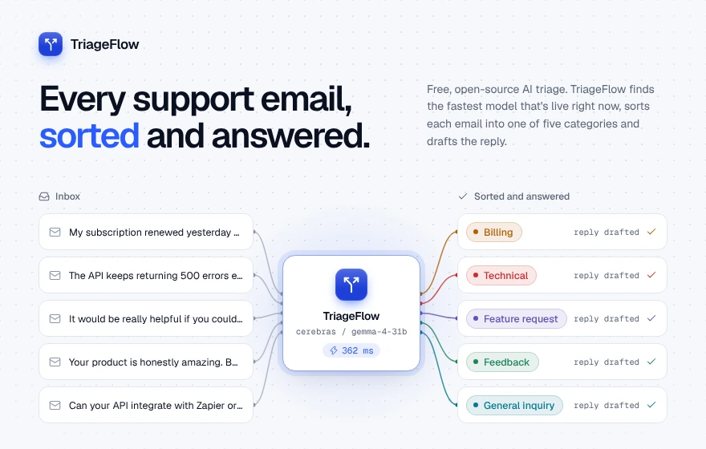
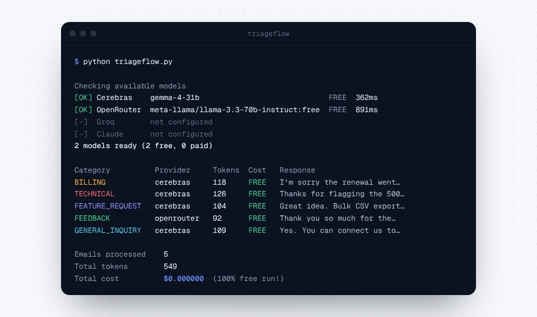
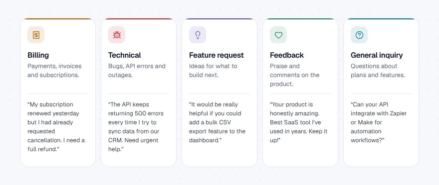

<picture>
  <source media="(prefers-color-scheme: dark)" srcset="docs/hero-dark.webp">
  
</picture>

<p align="center">
  <a href="#quick-start"><b>Quick start</b></a>
  &nbsp;·&nbsp;
  <a href="#how-it-works">How it works</a>
  &nbsp;·&nbsp;
  <a href="#supported-providers">Providers</a>
  &nbsp;·&nbsp;
  <a href="DOCUMENTATION.md">Documentation</a>
</p>

Support inboxes are mostly the same five kinds of email, and every one needs sorting and a first reply before a person even looks at it. TriageFlow does both. It reads each email, puts it in the right category and drafts a short, polite answer, using AI models that can cost nothing to run.

It's free and open source. Bring one free API key (Groq, OpenRouter, Gemini or Cerebras), or none at all with a local model through Ollama or LM Studio. Paid models such as Claude and OpenAI are supported but never required.

## See it run

<picture>
  <source media="(prefers-color-scheme: dark)" srcset="docs/terminal-dark.webp">
  
</picture>

One command checks which models are live, then sorts and answers every email you give it. The total at the bottom is the point: **$0** when only free providers are configured. *(Example session. The models and latencies are from a real health check run.)*

## Why TriageFlow

- **Free by default.** Local and free-tier models are always tried first. Paid APIs are used only if you add a key.
- **No silent failures.** Before touching a single email, TriageFlow sends a real request to every model you've configured. A wrong, retired or rate-limited model ID shows up straight away, not halfway through your inbox.
- **Always the fastest model.** Working models are ranked by how quickly they answered, and the fastest one gets the work.
- **Keeps going on its own.** If a provider stops answering mid-run, TriageFlow sets it aside and moves to the next one.
- **Gets smarter with use.** Every result is stored locally, and future emails in each category go to the model that has handled that category best.
- **Easy to extend.** Adding a provider is one entry in `providers.py`.

## Five categories

<picture>
  <source media="(prefers-color-scheme: dark)" srcset="docs/categories-dark.webp">
  
</picture>

Every email lands in exactly one of these, and each one gets a reply written for its category. The examples above come from the sample set in `data/`.

## How it works

1. **Health check.** Every configured provider gets a short real request. Only models that answer are used, ranked fastest first.
2. **Categorize.** The strongest available model reads the email and picks one of the five categories.
3. **Reply.** The cheapest working model drafts an answer of under 100 words, in the right tone for the category.
4. **Learn.** The result is saved to a local SQLite database, and the model that handled the category best gets the next email of that kind.

[ARCHITECTURE.md](ARCHITECTURE.md) explains each part in detail.

## Quick start

You need Python 3.9 or newer.

```bash
git clone https://github.com/wesper-01/TriageFlow.git
cd TriageFlow
python -m venv venv && source venv/bin/activate   # Windows: venv\Scripts\activate
pip install -r requirements.txt
cp .env.example .env                              # add one free key, or run Ollama
```

| Command | What it does |
| --- | --- |
| `python health_check.py` | Checks every configured provider and lists the ones that answer, fastest first. |
| `python triageflow.py` | Triages emails you paste in, one per line, and prints each category and reply. |
| `python test.py` | Runs the 1,000-email sample batch and saves the results to `results.csv`. |
| `python visualize.py` | Draws terminal charts from `results.csv`. |

[QUICKSTART.md](QUICKSTART.md) walks through setup step by step.

## Supported providers

| Provider | Cost | Runs | Get a key |
| --- | --- | --- | --- |
| Ollama | Free | On your machine | [ollama.com](https://ollama.com) |
| LM Studio | Free | On your machine | [lmstudio.ai](https://lmstudio.ai) |
| Groq | Free tier | Hosted | [console.groq.com](https://console.groq.com/keys) |
| OpenRouter | Free models | Hosted | [openrouter.ai](https://openrouter.ai/keys) |
| Google Gemini | Free tier | Hosted | [aistudio.google.com](https://aistudio.google.com/apikey) |
| Cerebras | Free tier | Hosted | [cloud.cerebras.ai](https://cloud.cerebras.ai/) |
| Claude | Paid, optional | Hosted | [console.anthropic.com](https://console.anthropic.com/) |
| OpenAI | Paid, optional | Hosted | [platform.openai.com](https://platform.openai.com/api-keys) |
| NVIDIA NIM | Paid, optional | Hosted | [build.nvidia.com](https://build.nvidia.com/) |

## Project structure

| Path | What it is |
| --- | --- |
| `triageflow.py` | The main entry point. |
| `providers.py` | Every provider and its candidate model IDs. Add new ones here. |
| `health_check.py` | The live check that runs before any email is processed. |
| `models.py` | One interface for calling any provider. |
| `triage.py` | Routing, fallback and learning. |
| `database.py` | Local SQLite storage for results and learned patterns. |
| `test.py`, `visualize.py` | The 1,000-email batch runner and its charts. |
| `data/` | Sample email sets. |

## Roadmap

- **Gmail integration.** Read unread mail through the Gmail API, triage it, and save each reply as a draft for a person to review. Nothing is ever sent automatically.
- **Outlook and IMAP** after Gmail.
- **Hermes Agent support,** so TriageFlow can run as an always-on agent on a server. It has already been tested this way, with real emails.

## Project status

Development is paused. TriageFlow does everything described above, and it was tested on the full 1,000-email set and on a Hermes Agent server. Running it every day on free-tier APIs, though, turned out to depend on rate limits and response times that no code can control. The **[documentation](DOCUMENTATION.md)** covers what testing showed, why I paused it and what it would take to pick it back up.

## Licence

MIT, see [LICENSE](LICENSE). Contributions are welcome, especially new free-tier providers and updates to model IDs that have changed. Icons are from Lucide (ISC). Fonts are Geist and Geist Mono (SIL OFL 1.1).
